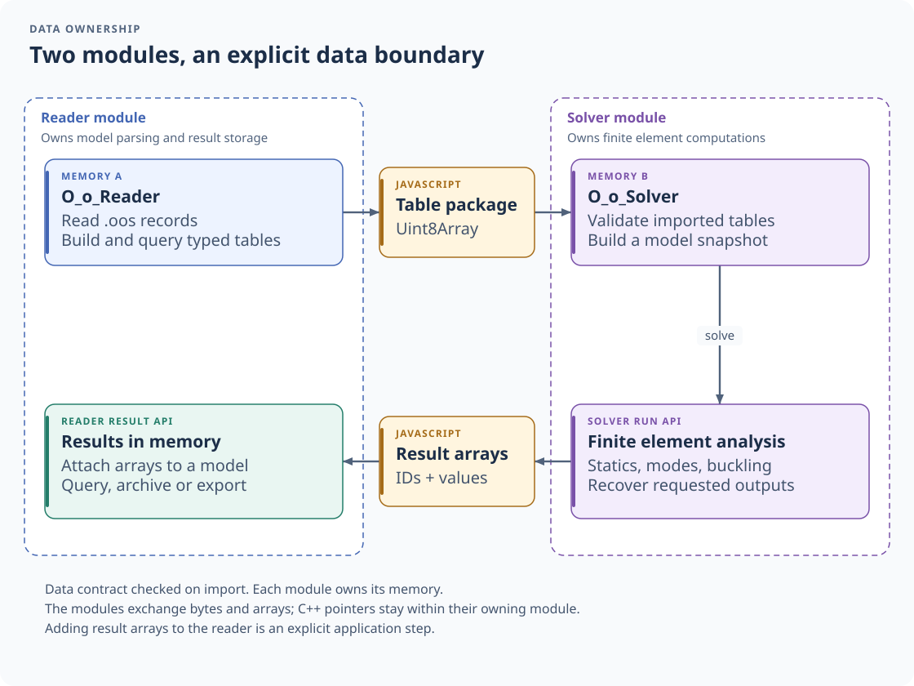
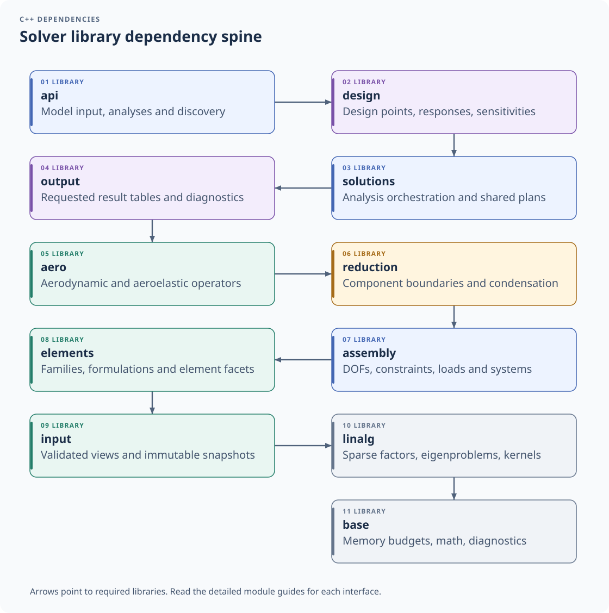
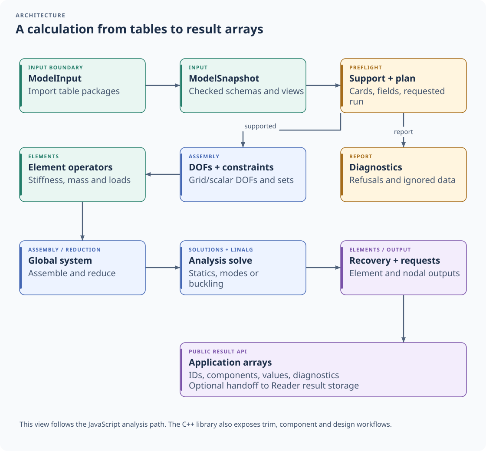
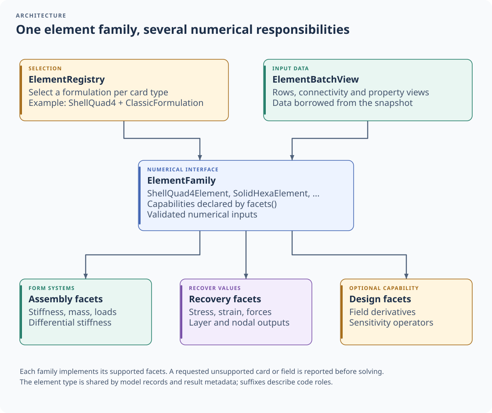

# Architecture

O_o_Solver turns validated model tables into finite element systems and result arrays. This guide follows the data
through the public entry points and shows where the implementation responsibilities sit.

## Reader and solver boundary

*The application coordinates the two modules. Their C++ libraries and WebAssembly memories stay independent.*

O_o_Reader parses `.oos` records and exposes query tables. `modelFromReader` obtains the tables the solver needs,
serializes them as table packages, and imports them through `api::ModelInput`. The solver checks the data contract
before constructing its model snapshot. The [table-package guide](table-package.md) describes the transport.

The imported byte package has an owner in the receiving module. The snapshot and its typed table views retain the
owners they borrow from. Sharing a column inside that module does not expose a pointer into the reader's memory.

The solver returns arrays with IDs, component names and values. An application can pass these arrays to the reader's
result API for querying, archiving or workbook export. That handoff is an explicit application operation.

## Library dependencies

*Each arrow points from a library to a directly required library. The chain follows the build definitions.*

The [module guide](modules.md) links the detailed responsibilities and entry points. The public facade sits above the
design and solution libraries. Numerical element code receives input views and uses linear algebra; it does not parse
model text. Platform access and memory budgets are confined to `base`.

The WebAssembly bindings in [Bindings.cpp](../wasm/src/Bindings.cpp) convert values between JavaScript and the C++
facade. The [API reference](api.rst) includes the facade headers and current JavaScript declarations.

## Calculation lifecycle

*Support, assembly, solving and recovery are distinct stages with their own data and diagnostics.*

1. **Import and snapshot.** `SnapshotBuilder` checks the columns, types and contract metadata, then produces an
   immutable `ModelSnapshot`. Optional tables are present only when the caller supplied them.
2. **Support and planning.** The selected analysis checks cards, field values, formulations and output requests.
   Inspect both refusals and ignored data before using a run.
3. **DOFs and assembly.** The assembly module constructs degree-of-freedom sets and constraint equations. Element
   families supply local operators; assembly and reduction form the systems to solve.
4. **Analysis.** The solution modules coordinate statics, modes and buckling using the factorization and eigenvalue
   machinery in `linalg`.
5. **Recovery and output.** Element recovery evaluates the requested fields. Output plans select the tables to return,
   including their row IDs, components, analysis steps and diagnostics.

The [input guide](../src/input/README.md), [assembly guide](../src/assembly/README.md),
[reduction guide](../src/reduction/README.md) and [solution guide](../src/solutions/README.md) cover these stages.
The C++ library also exposes component, trim and design workflows beyond the three JavaScript analysis entry points.

## Element families and formulations

*A family declares its capabilities through facets. The formulation is selected separately from the element type.*

`ElementRegistry` chooses one formulation for each card type. `ElementBatchView` presents rows, connectivity,
properties and materials from the snapshot. An `ElementFamily` then supplies the facets it supports: stiffness,
mass, loads, differential stiffness, recovery and design derivatives.

The common interface lets assembly request an operation without embedding the implementation of each element.
For example, `ShellQuad4Element` and `SolidHexaElement` have different numerical kernels but participate through the
same family interface. The [element guide](../src/elements/README.md) documents the formulations and their limits.

Model records and result `elementType` values use the same exact root. Code adds a role suffix, as in
`ShellQuad4Element` and `ShellQuad4Geometry`. See [element naming](naming.md) for the convention and compatibility.

## Execution and ownership

Native builds can use the project's thread pool. The WebAssembly build runs its work on the calling thread and uses
Memory64. Budgeted objects and retained owners govern the lifetime of imported data, factors and cached structures.
Release model objects held by native code with `delete()` after their last use.

The diagrams are committed SVG images. Their editable specifications and renderer are described in the
[documentation maintenance guide](documentation.md#architecture-images).
