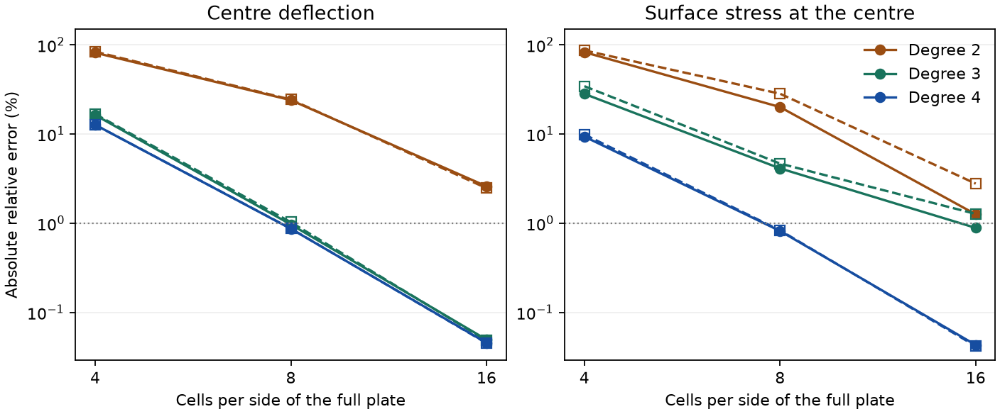

# Thin-plate bending with solid elements

On a simply supported square plate with a span-to-thickness ratio of 100, one layer of mixed four-node tetrahedra
in Auto gives **0.87% error in centre deflection and 0.83% in centre surface stress** on a distorted 8 × 8 mesh.
Doubling the resolution in the plane brings both errors below 0.05%. Keeping 8 × 8 cells and increasing to three
layers gives 0.87% and 0.88%. The results below quantify how much each refinement changes these two measurements.

## Model and reference

The 1 m × 1 m × 10 mm plate is homogeneous and isotropic, with Young's modulus 70 GPa and Poisson's ratio 0.3.
A uniform pressure of 1 kPa acts on the top face. A quarter of the plate is solved by symmetry. On the two supported
edges, diaphragm supports restrain vertical and edge-parallel displacement through the thickness and allow in-plane
displacement normal to the edge. On each symmetry plane, only displacement normal to the plane is restrained.
The vertical support reaction is 250 N on the quarter model.

The reference is a Fourier solution of three-dimensional linear elasticity with zero surface shear, zero normal
traction on the bottom face and the applied normal traction on the top. At the centre it gives a **downward
deflection of 0.633956885 mm**, averaged over the two faces. The in-plane normal stresses are equal by symmetry,
with **+2.873313 MPa on the bottom** and **−2.873463 MPa on the top**. Summing up to odd mode 1001 or 2001 gives
the same values to the precision shown. [Reference calculation](benchmarks/thin_plate_reference.py)

Mesh sizes refer to cells per side of the **full plate**. A hexahedral cell is one element. A tetrahedral cell is
split into six tetrahedra around the same body diagonal. Thus 8 × 8 with one layer gives 96 tetrahedra in the
quarter model. For a distorted mesh, interior node columns move by up to 20% of the initial cell width in each
in-plane direction. The edges remain straight and the two skins remain flat.

All tables give **absolute relative errors**. The stress error is the largest of the errors in σxx and σyy,
on either skin at the centre, over all incident elements **before nodal averaging**. Each face is compared with its
own signed reference. Peaks near a support, transverse shear and curved skins require separate benchmarks.

## Mixed tetrahedra by degree

The tetrahedra have four geometric nodes at every degree. The degree changes the approximation of the mixed fields.
Auto uses degree 4 for these solids. Auto and explicit degree 4 produced identical measured values on all ten meshes.

**One layer and 8 × 8 cells in the plane**

| Mixed degree | Deflection, regular | Deflection, distorted | Surface stress, regular | Surface stress, distorted |
| --- | ---: | ---: | ---: | ---: |
| 2 | 23.95% | 24.34% | 20.04% | 28.29% |
| 3 | 0.97% | 1.03% | 4.11% | 4.66% |
| 4 / Auto | 0.87% | 0.87% | 0.82% | 0.83% |

**Surface stress with in-plane and through-thickness refinement, distorted mesh**

| Mixed degree | 8 × 8, one layer | 8 × 8, two layers | 8 × 8, three layers | 16 × 16, one layer |
| --- | ---: | ---: | ---: | ---: |
| 2 | 28.29% | 29.79% | 31.04% | 2.78% |
| 3 | 4.66% | 3.63% | 3.58% | 1.27% |
| 4 / Auto | 0.83% | 0.86% | 0.88% | 0.042% |

At degree 3, three layers reduce the 8 × 8 stress error by about one percentage point. At degree 4, the larger
gain comes from resolving the variation of bending moment across the span. Even degree 4 gives a 12.67% deflection
error on a distorted 4 × 4 mesh with one layer. With 16 × 16 cells and one layer this drops to 0.045%.
In the figure, solid lines denote regular cells, dashed lines denote distorted cells, and the horizontal line marks 1%.



## Comparison with classical solids

The same regular 8 × 8 mesh, pressure and reference give the following results. The classical 8-node hexahedron uses
21 enhanced strain modes condensed inside each element (EAS-21). The 20-node hexahedron has mid-side nodes. Each tetrahedral row uses the same
six-way cell split.

| Element and formulation | Deflection, one layer | Deflection, three layers | Surface stress, one layer | Surface stress, three layers |
| --- | ---: | ---: | ---: | ---: |
| Mixed hexahedron, 8 nodes, Auto | <0.001% | <0.001% | 0.0084% | 0.0086% |
| Mixed tetrahedron, 4 nodes, Auto | 0.87% | 0.87% | 0.82% | 0.86% |
| Classical hexahedron, 20 nodes | 0.64% | 0.63% | 1.27% | 0.33% |
| Classical hexahedron, 8 nodes | 0.22% | 0.38% | 0.80% | 0.87% |
| Classical tetrahedron, 10 nodes | 24.35% | 24.13% | 21.04% | 22.41% |
| Classical tetrahedron, 4 nodes | 99.19% | 99.18% | 100.92% | 99.74% |

The classical 20-node hexahedron shows where extra layers help on this plate. The centre deflection changes little,
while the error in surface stress falls from 1.27% to 0.33%. For the mixed tetrahedron, a one-layer mesh refined in
the plane was the more accurate of the two refinement choices tested here.

### How much does the classical HEX8 improvement carry over to distorted cells?

The 8 × 8 plate has one brick through the thickness. Each row compares the same mesh, load and supports before and after the change to the default classical HEX8.

| Mesh | Centre deflection error, nine modes | Centre deflection error, EAS-21 | Surface stress error, nine modes | Surface stress error, EAS-21 |
| --- | ---: | ---: | ---: | ---: |
| Regular | 26.55% | **0.22%** | 24.58% | **0.80%** |
| Distorted by up to 20% | 70.84% | **49.96%** | 74.01% | **65.18%** |

The additional bilinear strain modes relax parasitic shear during bending. They are eliminated inside each element, so the brick still contributes 24 nodal translations. The remaining error on the distorted mesh is large. On the same distorted corner geometry the classical HEX20 gives **5.82%** error in deflection and **9.01%** in surface stress. [Andelfinger and Ramm, EAS solid elements](https://doi.org/10.1002/nme.1620360805) · [Trapezoidal cantilever comparison](structural-benchmark-comparison.md#solids-and-thermoelasticity)

### Why does the classical TET4 stay so stiff?

Each displacement component is affine on the four corners. Its derivative is constant, so a single tetrahedron can represent only one strain tensor. In bending the axial strain changes sign through the thickness. The 12 translations of a TET4 already span exactly six rigid motions and six independent constant strains. Once their elastic response is prescribed, changing the local quadrature cannot supply a bending mode. The classical TET10 introduces six shared mid-edge nodes and can represent a linear strain field. [Abaqus solid element library](https://docs.software.vt.edu/abaqusv2026/English/SIMACAEELMRefMap/simaelm-c-solidcont.htm)

The following classical results use one layer and the same three-dimensional reference. Each stress entry is the worst incident corner error on either skin. Surface stress can improve more slowly than centre displacement on a distorted mesh.

| Element and full-plate mesh | Regular deflection | Regular stress | Distorted deflection | Distorted stress |
| --- | ---: | ---: | ---: | ---: |
| TET4, 8 × 8 | 99.19% | 100.92% | 99.19% | 101.01% |
| TET4, 16 × 16 | 97.00% | 104.35% | 97.05% | 104.31% |
| TET4, 32 × 32 | 90.49% | 116.65% | 90.93% | 117.88% |
| TET10, 8 × 8 | 24.35% | 21.04% | 42.18% | 44.36% |
| TET10, 16 × 16 | 2.70% | 1.55% | 11.88% | 14.64% |
| TET10, 32 × 32 | 0.29% | 0.34% | 4.80% | 16.30% |

On the regular mesh, increasing the in-plane resolution to 32 × 32 brought both TET10 measurements below 0.35%. On the distorted mesh, the largest surface stress error rose between the last two refinements. A centre deflection within 5% therefore gives little assurance about individual corner stresses on this mesh.

## Reproduce the results

The archive contains 32 plain-text model files. The results file records 74 formulation and mesh combinations,
including the 40 mixed tetrahedron degree runs. Each entry contains the signed deflection error, absolute surface
stress error and the two centre node IDs in bottom-to-top order.
{download}`Download the model files <benchmarks/thin-plate-inputs.zip>` ·
{download}`Download the numerical results <benchmarks/thin-plate-results.json>`

With the Reader and Solver packages built as described in the [validation guide](testing.md), run these commands
from the repository root. The replay selects the formulation and degree for each model, checks the quarter reaction
and compares the errors with the recorded measurements. The reference script requires Python and NumPy.

```bash
python -m zipfile -e docs/benchmarks/thin-plate-inputs.zip build/thin-plate
node docs/benchmarks/replay-thin-plate.mjs
python docs/benchmarks/thin_plate_reference.py
```
